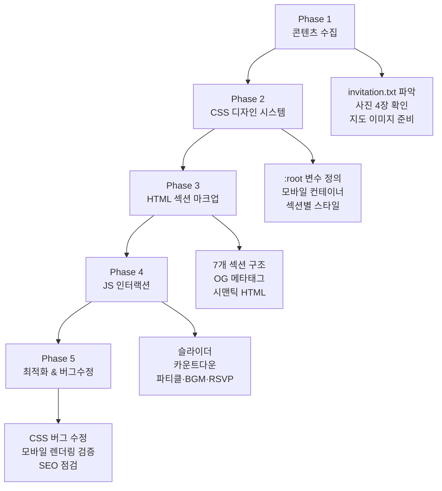

# 🎯 구현 계획서
## Re:Connect — 제48회 동창회 e-초대장

---

## 프로젝트 개요

| 항목 | 내용 |
|------|------|
| **프로젝트명** | Re:Connect — 제48회 동창회 e-초대장 |
| **행사일시** | 2032년 10월 1일 (토) 오후 5시 |
| **장소** | 창경궁 (서울특별시 종로구 창경궁로 185) |
| **접속 환경** | 스마트폰 전용 (모바일 퍼스트) |
| **배포 방식** | 정적 HTML 파일 — 별도 서버 불필요 |

---

## 기술 스택

| 레이어 | 기술 | 선택 이유 |
|--------|------|----------|
| **구조** | HTML5 Semantic | 가볍고 의존성 없음 |
| **스타일** | Vanilla CSS (CSS Variables) | 프레임워크 없이 완전한 제어 |
| **동작** | Vanilla JavaScript (ES6+) | 번들러·빌드 없이 즉시 실행 |
| **폰트** | Google Fonts (CDN) | Alex Brush · Cormorant Garamond · Noto Serif KR · Pretendard |
| **그래픽** | HTML5 Canvas API | 벚꽃/골드 파티클 배경 |
| **오디오** | Web Audio API | 외부 MP3 없이 합성음 생성 |

---

## 디자인 방향

### 테마: WordPress "Moments" 럭셔리 에디토리얼
- **컬러 팔레트**: 따뜻한 골드 (`#c5a880`) + 네이비 블랙 (`#1f1d1c`) + 페이퍼 베이지 (`#fdfcf9`)
- **타이포그래피**: 스크립트(Alex Brush) + 세리프(Noto Serif KR) + 디스플레이(Cormorant Garamond)
- **키 모티프**: 왁스 실링 엠블럼, 앤틱 L자 코너 오너먼트, 벚꽃 파티클

### 모바일 최적화 원칙
- 최대 너비 `440px` 컨테이너, 중앙 정렬
- `viewport-fit=cover` + `env(safe-area-inset-bottom)` iOS 노치 대응
- `min-height: 100dvh` 동적 뷰포트 높이 적용
- `user-scalable=no` 핀치줌 방지
- 터치 제스처 (스와이프) 지원

---

## 7개 섹션 설계

```
┌─────────────────────────────────┐
│  1. 헤더/커버                    │  왁스 실링 + 커버 사진 + BGM
├─────────────────────────────────┤
│  2. 초대글                       │  invitation.txt 원문 카드
├─────────────────────────────────┤
│  3. 사진 섹션 ★                  │  폴라로이드 슬라이더 (4장)
├─────────────────────────────────┤
│  4. 카운트다운 섹션 ★            │  실시간 D-Day 타이머
├─────────────────────────────────┤
│  5. 지도 섹션 ★                  │  300×300 창경궁 네이버 지도
├─────────────────────────────────┤
│  6. RSVP                        │  참석 여부 폼
├─────────────────────────────────┤
│  7. 푸터                         │  공유 버튼 + 연락처
└─────────────────────────────────┘
```
★ = 사용자 명시 요구사항

---

## 단계별 구현 순서


